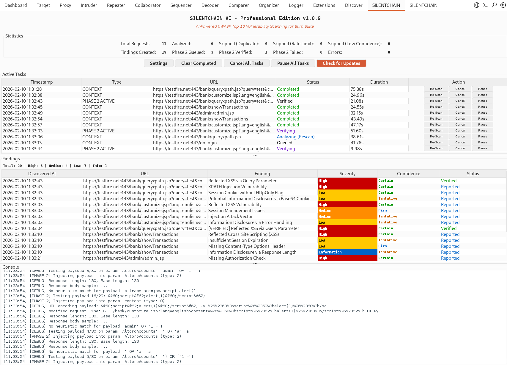
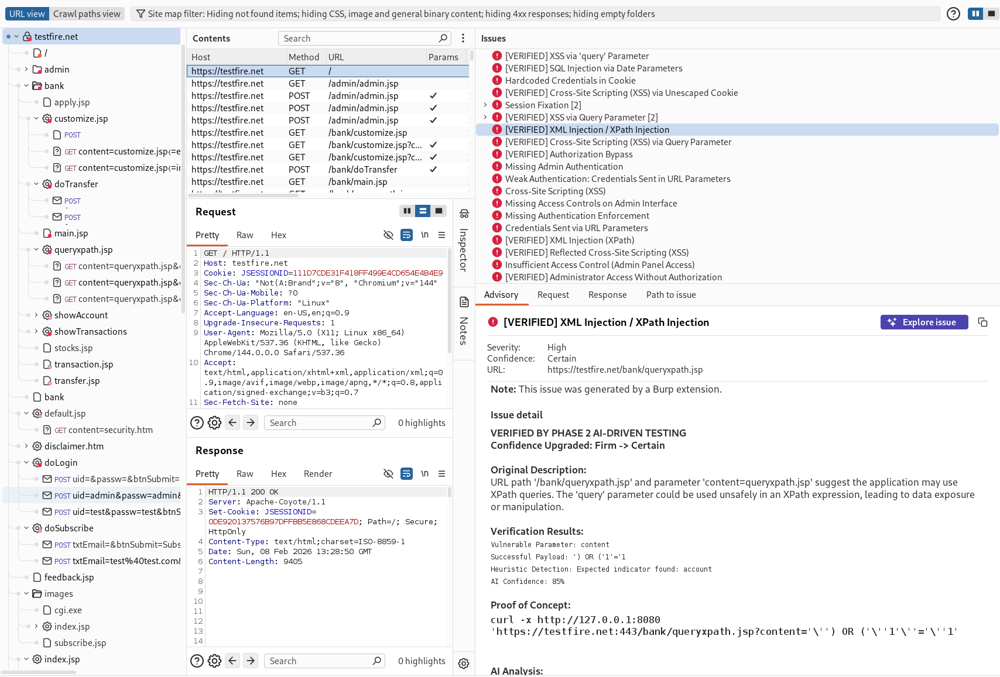

# SILENTCHAIN AI™ - Community Edition

<div align="center">


[](https://portswigger.net/burp)
[](https://www.java.com/)

### 🔗 ⛓️ 🔒

**AI-Powered Passive Vulnerability Analysis for Burp Suite**

*Intelligent • Silent • Adaptive • Comprehensive*

[🚀 Getting Started](#-quick-start) • [📖 Documentation](#-documentation) • [🔧 Configuration](#-configuration) • [📊 Benchmarks](BENCHMARK.md) • [⬆️ Upgrade to Pro](https://silentchain.ai)

[](https://youtu.be/yWJK4CvS5pE)

</div>

---



---

> **Note:** This is the Community Edition. Commercial and Professional Editions with advanced features are available separately.

## 🌟 Overview

**SILENTCHAIN AI™ - Community Edition** is a Burp Suite extension that brings the power of artificial intelligence to web application security testing. Using advanced AI models, SILENTCHAIN performs intelligent passive analysis of HTTP traffic to identify OWASP Top 10 vulnerabilities, security misconfigurations, and potential attack vectors.

### Why SILENTCHAIN?

Traditional security scanners rely on predefined signatures and patterns. **SILENTCHAIN AI™** goes beyond with:

- **🧠 AI-Powered Analysis**: Leverages state-of-the-art language models (Burp AI, Ollama, OpenAI, Claude, Gemini, Azure) for intelligent vulnerability detection
- **🎯 Context-Aware Detection**: Understands application logic and business context, not just pattern matching
- **⚡ Real-Time Scanning**: Analyzes traffic as it flows through Burp's proxy
- **📊 Professional Reporting**: Generates detailed findings with CWE, OWASP mappings, and remediation guidance
- **🔄 Zero False Positives**: AI validation reduces noise and focuses on real vulnerabilities
- **🆓 Community Edition**: Free passive analysis capabilities

---

## ✨ Features

### Core Capabilities

#### 🔍 **Passive AI Analysis**
- Automatic analysis of in-scope traffic as a Burp Scanner passive scan check (for example Burp's live passive audit of Proxy traffic); the passive check never sends requests to the target
- On-demand analysis of any request from the right-click menu
- OWASP Top 10 vulnerability detection
- CWE-mapped security findings
- Intelligent confidence scoring

#### 🎨 **Professional UI**
- Modern, intuitive dashboard
- Live findings panel with severity color-coding
- Task tracking and management
- Integrated console logging

#### 🤖 **Multi-AI Support**
- **Burp AI** (default; zero-config; prompts are sent through Burp to PortSwigger's Burp AI service and use Burp AI credits)
- **Ollama** (local, free, privacy-focused)
- **OpenAI** (GPT-4 / GPT-4o)
- **Claude** (Anthropic)
- **Gemini** (Google)
- **Azure OpenAI / Foundry**

#### 📋 **Smart Reporting**
- Detailed vulnerability descriptions
- Affected parameters identification
- CWE and OWASP mappings
- Remediation recommendations
- Direct links to security resources

#### 🛡️ **Data Privacy (DataSanitizer)**
- **Always on:** credentials are replaced with `[REDACTED]` before any AI request, whatever the sanitizer setting: cookie values, `Authorization` and API-key/token header values, and parameters / JSON fields named like credentials (password, token, api_key, session...) in the URL, URL-bearing headers (Referer, Location), the parameter sample and the request and response bodies (form, JSON including nested values, multipart, XML, HTML form inputs) (names, `Set-Cookie` attributes and the `Authorization` scheme are kept)
- **Sanitizer enabled by default** - additionally redacts secrets and PII in the rest of the exchange and neutralizes prompt-injection patterns, for every provider (Burp AI, Ollama and the cloud providers)
- Bidirectional redaction: sensitive values are replaced with `[REDACTED_*]` placeholders before sending to the AI provider, then restored in the response
- Detects and redacts:
  - **API keys** - OpenAI (`sk-`), GitHub (`ghp_`), AWS (`AKIA`), GitLab (`glpat-`), Slack (`xoxb-`)
  - **Authorization headers** - Bearer tokens, Basic auth
  - **Credentials** - password/secret/token fields, `user:pass@host` URIs
  - **Session cookies** - session IDs, CSRF tokens, JWTs, auth tokens
  - **Email addresses**
  - **IP addresses & hostnames** - target infrastructure details
- The sanitizer can be toggled off in Settings for advanced users (header redaction still applies)
- AI output is treated as untrusted: finding titles are sanitized and SILENTCHAIN's tables never render HTML

### Vulnerability Detection

SILENTCHAIN AI™ detects a wide range of security issues including:

| Category | Vulnerabilities |
|----------|----------------|
| **Injection** | SQL Injection, NoSQL Injection, Command Injection, LDAP Injection, XPath Injection |
| **Cross-Site Scripting** | Reflected XSS, Stored XSS, DOM-based XSS |
| **Authentication** | Broken Authentication, Session Management Issues, Credential Exposure |
| **Access Control** | IDOR, Broken Authorization, Privilege Escalation |
| **Cryptography** | Weak Encryption, Insecure SSL/TLS, Sensitive Data Exposure |
| **Configuration** | Security Misconfigurations, Default Credentials, Debug Enabled |
| **XXE** | XML External Entity Attacks |
| **Deserialization** | Insecure Deserialization |
| **Components** | Vulnerable Dependencies, Outdated Libraries |

---

## 🚀 Quick Start

### Prerequisites

- **Burp Suite Professional 2025.8 or later.** Burp Suite Community Edition and Burp Suite DAST are not supported: on Community Edition the extension loads, logs why, and stays idle.
- **'Use AI' enabled for SILENTCHAIN** in **Extensions** → **Installed**. It is off by default for manually loaded extensions (Burp asks when you install from the BApp Store). This gates **every** provider, including Ollama; if AI is turned off globally in Burp's AI settings, nothing is sent.
- **Java 21 runtime** (bundled with current Burp releases)
- **An AI provider** (one of the following):
   - **Burp AI** (default; zero-config; uses Burp AI credits)
   - [Ollama](https://ollama.ai) (free, local, privacy-focused)
   - OpenAI API key
   - Claude (Anthropic) API key
   - Gemini (Google) API key
   - Azure OpenAI / Foundry

### Installation

1. **Download the extension**
   - Grab the latest **[`silentchain-community-edition.jar`](https://github.com/silentchainai/SILENTCHAIN/releases/latest/download/silentchain-community-edition.jar)** from GitHub Releases (this link always serves the newest build). Specific versions (`silentchain-community-edition-X.Y.Z.jar`) are on the [Releases](https://github.com/silentchainai/SILENTCHAIN/releases) page.
   - Or build it from source: `./gradlew shadowJar` produces `build/libs/silentchain-community-edition-<version>.jar` (the Gradle wrapper is included; the JDK 21 toolchain is auto-provisioned if missing).

2. **Load it in Burp Suite**
   - Go to **Extensions** → **Installed** → **Add**
   - Set Extension type: **Java**
   - Select the downloaded `.jar` and click **Next**
   - In **Extensions** → **Installed**, enable **Use AI** for SILENTCHAIN (required for every provider)

3. **Configure your AI provider**
   - Click **Settings** on the **SILENTCHAIN Community** tab, or search Burp's Settings window for `SILENTCHAIN`
   - Pick a provider - **Burp AI** works with no configuration. For an external provider, set the API URL / key / model and click **Test Connection**. Changes apply immediately (there is no Save button).

4. **Start scanning**
   - Set your target scope in Burp (**Target** → **Scope**)
   - Turn on **passive analysis** with **Start Scanning** on the SILENTCHAIN Community tab (it is OFF by default), then browse the target through Burp's proxy (Burp's default live passive audit of Proxy traffic feeds in-scope items to SILENTCHAIN) - or right-click any request → **Analyze Request (SILENTCHAIN)** for on-demand analysis
   - Findings appear in the SILENTCHAIN Community tab and as native Burp issues (**Dashboard** / **Target** → **Site map** issues)

### Requirements

- **Cross-platform**: Windows, macOS, Linux
- **Burp Suite Professional** 2025.8 or later (Community Edition and Burp Suite DAST are not supported)
- **Java 21** (bundled with current Burp releases)

---

## 🔧 Configuration

### AI Provider Setup

SILENTCHAIN's settings live in Burp's **Settings** window: click **Settings** on the
SILENTCHAIN Community tab, or search Burp's Settings for `SILENTCHAIN`. Changes apply
immediately (there is no Save or Cancel). Each provider keeps its own API URL, API key and
model, so switching provider never reuses another provider's key. Settings from earlier
versions are migrated automatically.

Every provider, including Ollama, only runs when **Use AI** is enabled for SILENTCHAIN in
**Extensions** → **Installed**.

#### Option 1: Burp AI (Default - zero configuration)

**Requires Burp Suite Professional.** No API URL or key needed - prompts are sent through
Burp to PortSwigger's Burp AI service under PortSwigger's AI data-handling policy and consume
Burp AI credits from your account.

- Provider: `Burp AI`
- API URL / Key / Model: *(not required)*

#### Option 2: Ollama (Recommended for local / private use)

**Free, local, no API keys required**

1. Install Ollama:
   ```bash
   # macOS/Linux
   curl -fsSL https://ollama.ai/install.sh | sh
   
   # Windows
   # Download from https://ollama.ai/download
   ```

2. Pull a model:
   ```bash
   ollama pull deepseek-r1
   # or
   ollama pull llama3
   ```

3. Configure SILENTCHAIN:
   - Provider: `Ollama`
   - API URL: `http://localhost:11434` (the default; SILENTCHAIN calls `/api/chat` on the host you configure)
   - API Key: *(not used)*
   - Model: `deepseek-r1:latest`

#### Option 3: OpenAI

1. Get API key from [platform.openai.com](https://platform.openai.com)

2. Configure SILENTCHAIN:
   - Provider: `OpenAI`
   - API URL: `https://api.openai.com/v1`
   - API Key: `sk-...` (sent as a Bearer token)
   - Model: `gpt-4` or `gpt-3.5-turbo`

#### Option 4: Claude (Anthropic)

1. Get API key from [console.anthropic.com](https://console.anthropic.com)

2. Configure SILENTCHAIN:
   - Provider: `Claude`
   - API URL: `https://api.anthropic.com/v1`
   - API Key: Your Anthropic API key (sent in the `x-api-key` header)
   - Model: `claude-3-5-sonnet-20241022`

#### Option 5: Google Gemini

1. Get API key from [makersuite.google.com](https://makersuite.google.com)

2. Configure SILENTCHAIN:
   - Provider: `Gemini`
   - API URL: `https://generativelanguage.googleapis.com/v1`
   - API Key: Your Google API key (sent in the `x-goog-api-key` header, never in the URL)
   - Model: `gemini-1.5-pro`

#### Option 6: Azure OpenAI / Foundry

1. Create a model deployment in your Azure OpenAI / Foundry resource

2. Configure SILENTCHAIN:
   - Provider: `Azure Foundry`
   - API URL: `https://YOUR-RESOURCE.openai.azure.com`
   - API Key: Your Azure key (sent in the `api-key` header)
   - Model: your **deployment name**
   - Azure API Version: e.g. `2024-06-01` (the default)

### Settings Reference

| Setting | Description | Default |
|---------|-------------|---------|
| **AI Provider** | AI service to use | `Burp AI` |
| **Passive Analysis** | Automatically analyze in-scope items that Burp's live audit tasks and scans pass to SILENTCHAIN's passive scan check | `Off` (opt-in) |
| **API URL** | Provider endpoint (external providers; stored per provider) | *(provider default)* |
| **API Key** | Authentication key (external providers; stored per provider) | *(empty)* |
| **Model** | AI model name (external providers; stored per provider) | *(provider default)* |
| **Max Tokens** | Response length limit | `2048` |
| **Third-party AI timeout (s)** | Response timeout for third-party providers and for the right-click response fetch (Burp AI uses Burp's own limits) | `120` |
| **Sanitizer** | Redact secrets/PII and neutralize prompt injection before sending (credential headers are always redacted) | `On` |
| **Per-host Requests/Minute** | Passive analyses per host per minute | `10` |
| **URL Dedup Window (min)** | Skip a method + URL already analyzed passively within this window | `60` |
| **Verbose Logging** | Enable detailed logs | `On` |

---

## 📖 Documentation

### How It Works

1. **Burp Scanner passive check**: Burp's live audit tasks and scans (for example Burp's default live passive audit of Proxy traffic) hand each audited request/response to SILENTCHAIN's passive scan check. When no other analysis is queued, the check waits up to 60 seconds and returns the findings to Burp Scanner; otherwise the findings are added to Burp's issues when the analysis completes. The passive check never sends requests to the target. Burp scans and crawls also feed in-scope items, so AI usage can rise during scans.
2. **Scope Filtering**: Passive analysis only covers in-scope targets (configure in Burp's Target Scope), and only runs while SILENTCHAIN's passive analysis is ON and its tasks are not paused
3. **Throttling**: Per-URL de-duplication, a per-host rate limit (default 10/min) and a passive backlog cap (16) bound how much traffic reaches the AI
4. **AI Analysis**: Sends a capped, redacted summary of the request/response to the selected provider, only when **Use AI** is enabled for SILENTCHAIN in Burp
5. **Vulnerability Detection**: AI identifies security issues based on OWASP Top 10 patterns
6. **Finding Generation**: Creates Burp issues with severity, confidence, and remediation; findings below 50% AI confidence are dropped

### Finding Confidence Levels

| Level | AI Confidence | Meaning |
|-------|---------------|---------|
| **Certain** | 90-100% | High confidence, verified vulnerability pattern |
| **Firm** | 75-89% | Strong indicators, likely vulnerable |
| **Tentative** | 50-74% | Potential issue, requires manual verification |

### UI Components

#### 📊 **Statistics Panel**
- Total Requests: Items the passive check considered
- Analyzed: Analyses started (passive and right-click)
- Skipped (Duplicate): Prevented redundant analysis
- Skipped (Rate Limit): Over the per-host rate limit
- Skipped (Low Confidence): Findings below 50% AI confidence
- Findings Created: Total vulnerabilities found
- Skipped (Backlog): Passive items dropped because the backlog was full (replaces the old "Cache Hits" counter)
- Errors: Analysis failures

#### 📋 **Active Tasks**
- Shows queued and running analyses
- Status tracking (Queued, Analyzing, Paused, Completed, Skipped, Cancelled, Error)
- Duration timing
- **Cancel All Tasks**, **Pause All Tasks** / **Resume All Tasks** and **Stop Scanning** also apply to queued work
- A failed analysis shows as an **Error** task, with a stack trace in the extension's **Errors** tab (**Extensions** → **Installed**)

#### 🔍 **Findings Panel**
- All detected vulnerabilities
- Severity-based color coding:
   - 🔴 **High** - Critical vulnerabilities
   - 🟠 **Medium** - Important security issues
   - 🟡 **Low** - Minor vulnerabilities
   - 🔵 **Information** - Security notes
- Confidence levels
- Discovery timestamps

#### 🖥️ **Console**
- Real-time logging
- AI connection status
- Analysis progress
- Error messages

---

## 🎯 Usage Examples

### Basic Workflow

1. **Set Target Scope**
   ```
   Burp → Target → Scope → Add
   Example: https://example.com/*
   ```

2. **Browse Application**
   - Click **Start Scanning** on the SILENTCHAIN Community tab (passive analysis is OFF by default)
   - Configure browser proxy to Burp (127.0.0.1:8080)
   - Navigate through the target application
   - SILENTCHAIN analyzes in-scope traffic in the background, through Burp's live passive audit of Proxy traffic (Burp's default). If Burp pauses its tasks (for example when a project is reopened), SILENTCHAIN's passive analysis pauses too.

3. **Review Findings**
   - Check `SILENTCHAIN` → `Findings` panel
   - Or Burp's `Dashboard` / `Target` → `Site map` issues (integrated with Burp)

### Context Menu Analysis

Right-click any request in:
- Proxy History
- Site Map
- Repeater

Select: `Analyze Request (SILENTCHAIN)`

This forces analysis even if the URL was previously scanned. If the item has no response,
SILENTCHAIN sends the request once to capture one. The first analysis asks for data-handling
consent.

Repeater traffic is analyzed automatically only if a live audit task covers Repeater;
otherwise use the context menu.

### Manual Verification

1. Open the finding in Burp's issue view (`Dashboard` or `Target` → `Site map`)
2. Review the detailed description and evidence
3. Check affected parameters
4. Follow the CWE/OWASP references for more information
5. Manually test using Burp Repeater/Intruder

---

## 🆚 Community vs Professional

| Feature | Community (Free) | Professional |
|---------|------------------|--------------|
| **AI-Powered Passive Analysis** | ✅ | ✅ |
| **OWASP Top 10 Detection** | ✅ | ✅ |
| **Multi-AI Support** | ✅ | ✅ |
| **Professional UI** | ✅ | ✅ |
| **CWE/OWASP Mapping** | ✅ | ✅ |
| **Deduplication** | ✅ | ✅ |
| **Phase 2 Active Verification** | ❌ | ✅ |
| **Advanced Payload Libraries** | ❌ | ✅ |
| **WAF Detection & Evasion** | ❌ | ✅ |
| **Out-of-Band (OOB) Testing** | ❌ | ✅ |
| **Burp Intruder Integration** | ❌ | ✅ |
| **Automatic Fuzzing** | ❌ | ✅ |
| **Priority Support** | ❌ | ✅ |

### ⬆️ Upgrade to Professional

**SILENTCHAIN Professional** adds active verification capabilities:

- 🎯 **Phase 2 Verification**: Automatically validates findings with exploit payloads
- 🛡️ **WAF Detection**: Identifies and adapts to web application firewalls
- 📚 **Curated Payload Libraries**: Battle-tested OWASP payloads
- 🌐 **OOB Testing**: Detects blind vulnerabilities (SSRF, XXE, etc.)
- 🔄 **Burp Intruder Integration**: Auto-configures fuzzing attacks
- ⚡ **Smart Fuzzing**: AI-generated payloads for maximum coverage

[](https://youtu.be/yWJK4CvS5pE)

**See it in action** - watch the full [SILENTCHAIN Professional demo](https://youtu.be/yWJK4CvS5pE) to see AI-powered active verification, WAF evasion, and automated fuzzing at work.

**Contact us for commercial licensing and professional editions:** support@sn1persecurity.com

---

## 🛠️ Troubleshooting

### Common Issues

#### "AI connection test failed"

**Solution:**
- Make sure **Use AI** is enabled for SILENTCHAIN in **Extensions** → **Installed** and AI is not turned off in Burp's AI settings (required for every provider, including Ollama)
- Check AI provider is running (Ollama: `ollama list`)
- Verify API URL is correct
- For cloud providers, confirm API key is valid
- Check network connectivity

#### "No findings detected"

**Solution:**
- Verify target is in scope (`Target` → `Scope`)
- Make sure passive analysis is ON (**Start Scanning**), **Use AI** is enabled, and SILENTCHAIN's and Burp's tasks are not paused
- Ensure traffic is flowing through Burp Proxy and a live passive audit task covers it (Burp's default). The **Runtime Status** line shows `Waiting for Burp Scanner (needs a live audit task)` until Burp first calls the passive check
- Check Console for errors
- Try manual analysis (right-click → `Analyze Request (SILENTCHAIN)`)

#### "Extension fails to load"

**Solution:**
- Confirm the extension type was set to **Java** when loading the `.jar`
- Verify you are running Burp Suite Professional 2025.8 or later with a Java 21 runtime (on Community Edition the extension loads but stays idle and logs why)
- Review **Extensions → Installed → (SILENTCHAIN Community Edition) → Errors / Output**
- Re-download the `.jar` if the file may be corrupted

#### High Memory Usage

**Solution:**
- Reduce Max Tokens setting (Settings → AI Provider)
- Clear completed tasks regularly
- Use lighter AI models (e.g., `llama3` instead of `deepseek-r1`)

### Debug Mode

Enable verbose logging (on by default):
1. SILENTCHAIN's settings (Burp `Settings` window) → `Advanced`
2. Check `Verbose Logging`
3. Review Console for detailed output

---

## 🤝 Contributing

This project does **not accept outside contributions**. See [CONTRIBUTING.md](CONTRIBUTING.md) for details.

### Reporting Bugs

1. Check [existing issues](https://github.com/silentchainai/SILENTCHAIN/issues)
2. Create a new issue with:
   - Burp Suite version
   - SILENTCHAIN version
   - AI provider/model
   - Steps to reproduce
   - Error messages (from Console)

### Feature Requests

Open an issue with tag `enhancement`:
- Describe the feature
- Explain use case
- Provide examples if possible

---

## 📄 License

SILENTCHAIN AI™ CE is **source-visible but proprietary software**. By using this software, you agree to the terms in the [LICENSE](LICENSE) file.

### PortSwigger BApp Store

PortSwigger Ltd. is granted explicit permission to redistribute, host, and bundle this software within Burp Suite and the BApp Store free of charge to users. All other redistribution is prohibited without written permission.

---

## ⚖️ Responsible Use

**Do not use this software for unauthorized access or activities outside systems you own or have explicit permission to test.**

### Data Handling and Third-Party AI Disclosure

> **See [PRIVACY.md](PRIVACY.md) for the full privacy notice**, including the per-provider data-residency table and your responsibilities when scanning sensitive targets.

SILENTCHAIN analyzes HTTP requests and responses intercepted by Burp Suite. Depending on the AI provider you select, this data may be transmitted to PortSwigger's Burp AI service or to third-party cloud services. Nothing is sent to any provider unless **Use AI** is enabled for SILENTCHAIN in Burp.

#### Which providers see your data

| Provider | Data Destination | Data Transmitted |
|----------|-----------------|------------------|
| **Ollama** | The Ollama host you configure (default `http://localhost:11434`) | Nothing leaves your machine when Ollama runs locally |
| **OpenAI** | OpenAI, L.L.C. servers (`api.openai.com`) | HTTP request/response content from in-scope targets |
| **Claude** | Anthropic, PBC servers (`api.anthropic.com`) | HTTP request/response content from in-scope targets |
| **Gemini** | Google LLC servers (`generativelanguage.googleapis.com`) | HTTP request/response content from in-scope targets |
| **Azure OpenAI** | Your Azure OpenAI / Foundry resource | HTTP request/response content from in-scope targets |
| **Burp AI** | PortSwigger's Burp AI service, via Burp, under PortSwigger's AI data-handling policy (uses Burp AI credits) | HTTP request/response content from in-scope targets |

For each analyzed request, SILENTCHAIN sends a capped summary to the selected provider: the URL, method, status and MIME type, a sample of up to 5 parameters, the first 10 request and response headers, and the request and response bodies (truncated). Both passive and right-click analysis only send in-scope targets. Credentials are always replaced with `[REDACTED]` before any AI request, whatever the sanitizer setting: cookie values (in the `Cookie` / `Set-Cookie` headers and in the parameter sample), `Authorization`-style and API-key/token header values, and parameters, JSON fields and multipart fields named like credentials (password, token, api_key, session...) in the URL, URL-bearing headers (Referer, Location), the parameter sample and the request and response bodies (form, JSON including nested values, multipart, XML, HTML form inputs). Cookie and parameter names, `Set-Cookie` attributes and the `Authorization` scheme are kept, and an empty value stays empty so a missing token is still visible. The built-in **DataSanitizer** (enabled by default, applied to every provider) also redacts API keys, credentials, session tokens, and other sensitive patterns before transmission, but it cannot guarantee removal of all sensitive data from request/response bodies.

#### Regulated data restriction

**Do not submit regulated data to cloud AI providers.** This includes:

- **PHI** (Protected Health Information) under HIPAA
- **PCI DSS** cardholder data (credit card numbers, CVVs, etc.)
- **EU personal data** subject to GDPR (Art. 13 requires disclosure of sub-processors)
- **CCPA-covered personal information** (Cal. Civ. Code 1798.100 et seq.)

If your target application processes any of the above data categories, you **must** use a local AI provider (Ollama) or ensure you have appropriate data processing agreements with the cloud provider and legal authorization to transmit such data.

#### No telemetry

SILENTCHAIN itself does not collect, store, or transmit any usage data, telemetry, or analytics. All data flows are directly between your Burp Suite instance and your selected AI provider.

#### Best practices

1. **Use Ollama on your own machine** for sensitive or regulated environments (100% local, private)
2. **Enable DataSanitizer** (on by default) when using cloud providers
3. **Review your AI provider's data retention and privacy policies** before use
4. **Never test production systems** without authorization
5. **Sanitize findings and logs** before sharing externally

---

## 💬 Support & Community

### Get Help

- 📚 **Documentation**: [Documentation](#-documentation)
- 🐛 **Issues**: [GitHub Issues](https://github.com/silentchainai/SILENTCHAIN/issues)
- ✉️ **Email**: support@silentchain.ai

### Stay Updated

- ⭐ **Star** this repository
- 👁️ **Watch** for updates
- 🐦 **X (Twitter)**: [@silentchainai](https://x.com/silentchainai)

---

## 🙏 Acknowledgments

Built by:
- [@xer0dayz](https://x.com/xer0dayz) at [@Sn1perSecurity](https://sn1persecurity.com) LLC

Built with:
- [Burp Suite](https://portswigger.net/burp) by PortSwigger
- [Ollama](https://ollama.ai) for local AI
- [OpenAI](https://openai.com) for GPT models
- [Anthropic](https://anthropic.com) for Claude
- [Google](https://ai.google) for Gemini

Inspired by the security community's dedication to making the web safer.

---

## ™️ Trademark Notice

"SILENTCHAIN AI™", "SILENTCHAIN™", and the SILENTCHAIN AI logo are trademarks of SN1PERSECURITY LLC. Unauthorized use is prohibited.

## Legal Notices

See [NOTICE](NOTICE) for third-party trademark attributions.

---

<div align="center">

### 🔗 ⛓️ 🔒

**SILENTCHAIN AI™** - *Intelligent Security Testing for the Modern Web*

[Website](https://silentchain.ai) • [Documentation](#-documentation) • [Professional Edition](https://silentchain.ai/) • [Professional Demo](https://youtu.be/yWJK4CvS5pE)

**Copyright © 2026 SN1PERSECURITY LLC. All rights reserved.**

</div>